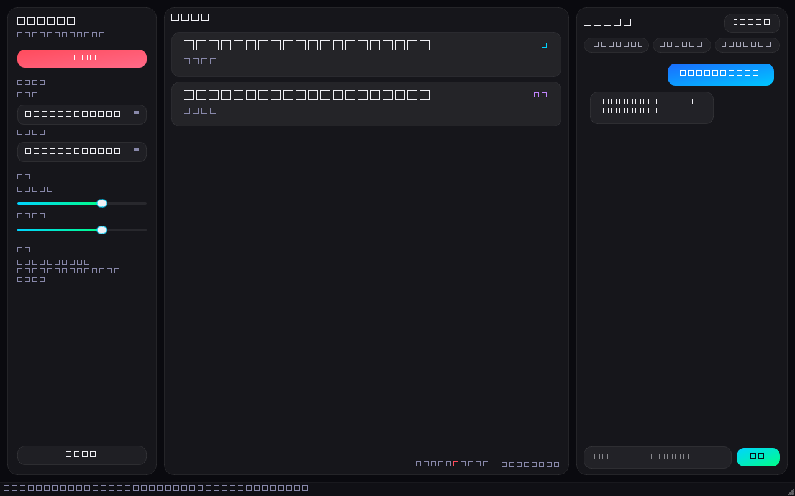
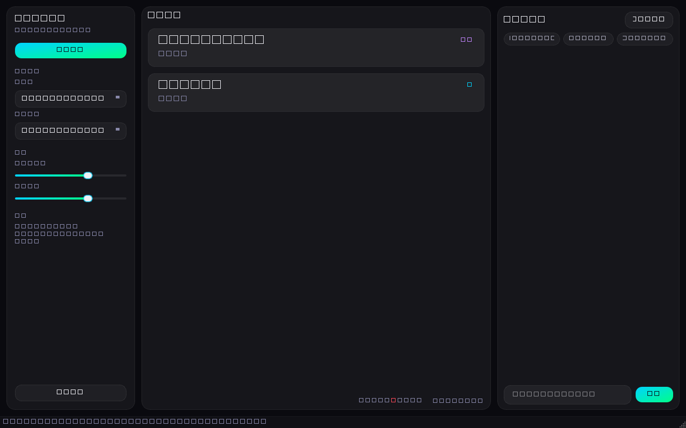

# 实时对话记录 · 字幕翻译 · AI 问答

一款 Windows 桌面软件：实时录制麦克风和系统声音，把中文对话转成文字以滚动字幕显示，自动翻译成英文，并支持基于对话内容的 AI 问答（DeepSeek）。

## 功能

- **双音频采集**：麦克风 + 系统声音（WASAPI 回环）同时录制并混合
- **实时语音识别**：本地 faster-whisper，离线识别中文（可配置模型大小）
- **流式临时字幕**：说话过程中先显示灰色临时字幕，停顿后定稿，延迟约 0.5~1 秒
- **说话人标记**：麦克风标为「我」、系统声音标为「对方」，字幕和 AI 上下文都带说话人
- **上下文翻译 + 术语表**：翻译参考前文保持语气一致，支持 glossary.json 术语对照
- **直播滚动字幕**：只显示最新 1-2 条，原文 + 译文成对滚动显示，带自动滑入/滑出动画
- **AI 问答**：随时提问，AI 结合本次对话内容（含自动摘要）回答
- **对话记忆**：自动摘要 + 滚动窗口 + 关键词检索，长对话也能被 AI 记住
- **自动简体化**：识别结果经 OpenCC 自动转简体，避免出现繁体字
- **自动存档**：每次会话以 JSONL 保存到 `sessions/` 目录（含说话人字段）

## 快速开始

```bat
:: 首次：创建虚拟环境并安装依赖
python -m venv .venv
.venv\Scripts\python.exe -m pip install -r requirements.txt

:: 启动
run.bat
```

也可以直接双击 `run.bat` 启动（需先完成上面的安装步骤）。

## 配置（.env）

首次运行前在 `.env` 中填写：

| 配置项 | 说明 |
|---|---|
| `DEEPSEEK_API_KEY` | DeepSeek API Key（必填，用于翻译和问答） |
| `ASR_MODEL` | 识别模型：`tiny`/`base`/`small`/`medium`/`large-v3`（越大越准越慢） |
| `ENERGY_THRESHOLD` | 语音检测灵敏度（默认 300，背景噪音大时可调高） |
| `MIC_VOLUME` / `SYS_VOLUME` | 两路音源的默认音量 |
| `HF_ENDPOINT` | HuggingFace 镜像地址，国内网络无法直连时使用 |
| `STREAM_HOP_MS` | 临时字幕刷新间隔（默认 700 毫秒，越小越实时） |
| `GLOSSARY_PATH` | 术语表文件路径（默认项目根目录 glossary.json） |

`DEEPSEEK_API_KEY` 已写入 `.env`，该文件已被 `.gitignore` 忽略，不会提交到 git。

## 使用说明

1. 启动后在左栏选择麦克风和系统声音设备（首次自动选中默认设备）
2. 点击「开始录音」，对着麦克风说话或播放系统声音
3. 中栏显示实时字幕：说话时先出现灰色临时字幕，停顿后变成正式字幕（说话人 + 原文 + 英文翻译）
4. 右栏随时输入问题与 AI 交互，AI 会结合本次对话内容（含摘要与历史检索）回答
5. 点击「停止录音」结束会话，记录自动保存

## 截图





## 项目结构

```text
app/
  audio/        音频采集（麦克风+回环）、语音分段
  asr/          faster-whisper 流式识别
  ai/           DeepSeek 翻译/问答客户端、对话记忆
  ui/           PySide6 界面（滚动字幕、问答面板）
  storage/      JSONL 会话存档
  controller.py 线程与信号编排
scripts/        冒烟验证脚本（设备/API/模型/GUI）
tests/          pytest 单元测试
```

## 常见问题

**模型下载失败 / 超时**

国内网络无法直连 HuggingFace 时，在 `.env` 中设置：

```env
HF_ENDPOINT=https://hf-mirror.com
HF_HUB_DISABLE_XET=1
HF_HUB_DISABLE_SYMLINKS_WARNING=1
```

**没有系统声音（回环）设备**

界面会提示"未检测到系统声音回环设备"。请确认声卡驱动支持 WASAPI 共享模式，或更新声卡驱动后重启软件；没有回环设备时仍可使用麦克风。

**识别不准或太慢**

在 `.env` 中更换模型：`ASR_MODEL=medium`（更准更慢）或 `ASR_MODEL=base`（更快）。有 NVIDIA 显卡时把 `ASR_DEVICE=cuda` 可大幅提速。

**翻译延迟**

翻译按"句"进行，每句说话停顿后触发。如果希望翻译更快，可适当降低 `ENERGY_THRESHOLD` 或缩短静音判定。

## 风险提示

- 实时识别准确率受麦克风、环境噪音、语速影响
- 首次启动需要下载识别模型（约 100MB ~ 460MB）
- DeepSeek API Key 请妥善保管，泄露后可在 DeepSeek 控制台重置

## 许可证

本项目采用 MIT 许可证，详见 [LICENSE](LICENSE)。
